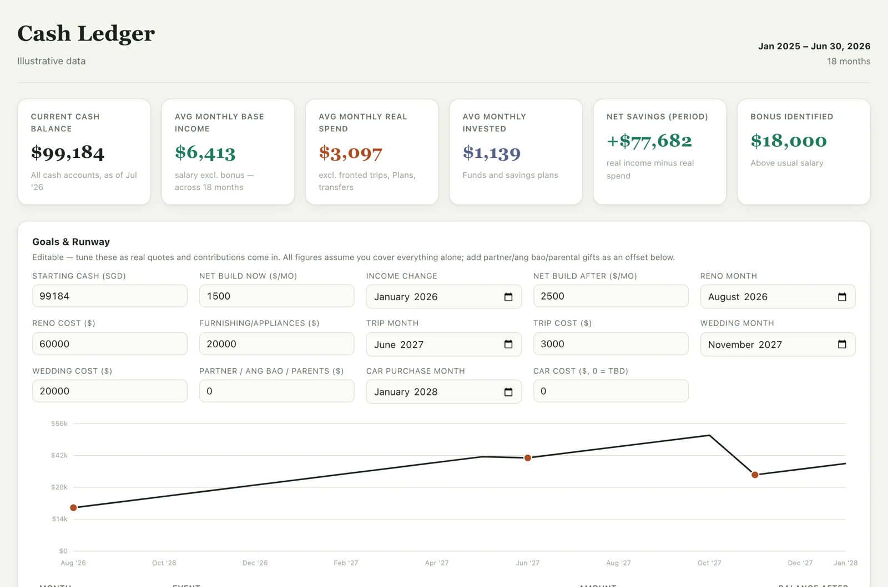
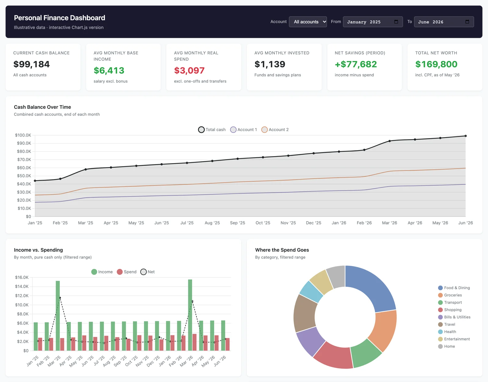

Turned 80 PDF bank statements across 5 Singapore banks into a clean, structured financial picture — with Claude handling the messy parts: OCR on scanned HSBC images, iterative PII redaction (caught real leaks along the way), and correcting mis-tagged transactions. Delivered a self-contained interactive dashboard with live goal-tracking for reno, travel, and wedding.

## Problem

My finances were scattered across 5 Singapore banks, and not seeing the whole picture made me worry about whether I was on track. I wanted one place that combines everything, summarises it, and shows progress toward my big milestones: the home renovation, the wedding and a car. The only full record was 80 PDF statements. Bank apps each show their own slice, some statements are scanned images, and credit cards and bank accounts use opposite sign conventions.

## How it works

1. **Extract.** Text-based statements are parsed with `pdftotext`, and each one is checked against the statement's own printed subtotal or balance. Scanned HSBC statements have no text layer, so they are OCR'd with Tesseract and reconciled against their previous and total balances.
2. **Redact and normalise.** Names, ID numbers, card and account numbers, and third-party names on transfers are removed. Credit card signs are flipped so negative means money out everywhere.
3. **Categorise.** Rule-based categories with a priority order, plus a short list of confirmed one-off adjustments.
4. **Dashboard.** Monthly aggregates are injected into a self-contained HTML dashboard with KPIs, trends, category breakdown and editable goals and runway.

One command reruns everything when new statements arrive.

*The interactive version: filter by account and date range to see cash over time, income against spending and where the money goes. Made-up numbers, same layout as my real one.*

*The planning view, shown here with made-up numbers. My real data stays private. The Goals & Runway section is editable, so I can test what-ifs like a later reno or a bigger wedding budget.*

## Key decisions

- **Reconcile every statement.** Each parsed statement must match its own printed totals. A parser that silently drops a row would make every later number wrong, and this catches it.
- **Rules over an LLM for categories.** Categories come from explicit merchant rules, so the same transaction always lands in the same bucket and fixes are one-line edits. Claude helped write and correct the rules, but doesn't categorise at runtime.
- **PII stays out of outputs.** Intermediate files with personal data live in a separate working folder, and terminal output is a PII-free summary.
- **One-offs handled explicitly.** Bonus months are tracked separately from regular income, and about $25K of group travel I paid for and was reimbursed for is excluded as pass-through.

## What broke and how I fixed it

- **OCR picked up the sidebar.** On scanned HSBC statements, the page 1 sidebar bled into the transaction table. Cropping page 1 before OCR fixed it.
- **Redaction leaked, then over-redacted.** The first pass missed two names and 52 name fragments, and another rule blanked out CPF entries that weren't personal data. It took several rounds, each re-checked against the output.
- **A growing "Other" bucket.** New merchants fell into "Other". Most of it was fixed by adding merchant keywords to the rules.

## Limits

Built for my own accounts, so the parsers fit these 5 banks' layouts. The code and data stay private.
